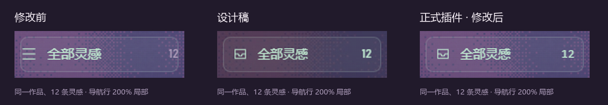
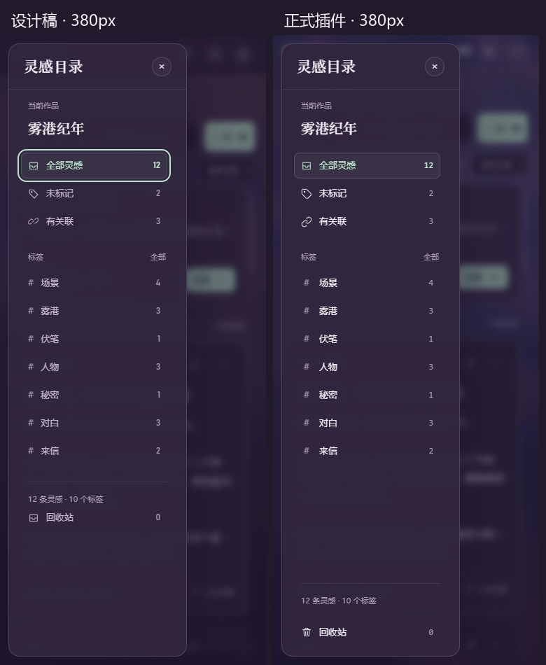

# 灵感界面完善 · 2026-11-08

本轮在原工作区增量修改，以「灵感融合总稿」B 式开放侧栏为基准。正式源码与本仓库构建的 `assets/app` 已更新。截图和实录使用正式构建、独立 Chrome 和随机本地源中的隔离演示库；未访问真实作品库，未提交、发布或重启宿主。

[可点击对照页](index.html) · [操作实录](snippets-plugin.mp4) · [逐项检查和尺寸数据](release-checks.json) · [验证汇总](validation.json) · [独立复核](REVIEW.md)

## 用户指出的导航行比例

根因是模块通用按钮重置的优先级高于侧栏行：`font: inherit` 将标签变成 14px，`padding: 0` 清掉了设计留白。现已在侧栏组件范围明确覆盖，并校验实际计算样式。

| 项目 | 原正式构建 | 本轮正式构建 |
|---|---|---|
| 导航行 | 37px；行距 0 | 37px；行距 3px |
| 内边距 | 实际被覆盖为 0 | 上下 8px、左右 10px |
| 标签／图标／计数 | 标签继承字号，三横线图标，计数灰色 | 13px／16px 细线收纳盒／12px 等宽数字 |
| 选中反馈 | 标签与计数不同色 | 图标、标签、计数统一薄荷色 |
| 数字列 | 随位数挤压标签 | 固定列宽、右对齐，完整数值保留在可访问文本中 |
| 分组标题 | 继承正文样式 | 11px 弱化辅助色 |
| 宽屏侧栏 | 开放式 | 保持开放式，174px；950–1199px 为170px |
| 手机目录 | 宽度拉满，方角 | 恢复设计稿255px宽、16px圆角，与中窄屏共用组件 |

作品名保持20px宋体、32px行盒，不纵向压缩。长标题与标签单行省略，提供完整名称提示。作品信息与三个主导航固定，只有过长标签列表滚动；统计和回收站留在底部。默认七项不出现额外滚动条，展开可访问全部标签。

## 完成的交互与数据链路

- 标签按片段首次出现建立稳定顺序，后续新增追加；计数变化不重排。侧栏和拼板共用序列，每个真实标签独立成列，内置未标记组采用独立ID。
- 编辑表单持续更新作品内草稿，再次编辑沿用草稿；手札、拼板保存选中项和各自纵横滚动。修复 Ctrl/Cmd+S、组合输入保护和窄屏正文缺失。
- 草稿和界面状态按作品保存；异步读取只应用当前作用域，防抖写入捕获作品和内容快照。读取或写入失败保留输入并显示重试；模态内部也能重试。
- 40步撤销／重做按作品管理，跨视图和模块保留，涵盖记录、修改、标签、关联、顺序、删除、恢复和转换。输入框使用浏览器文字撤销。该操作历史保存在会话内，刷新后仍保留已保存数据与草稿。
- 原片段被外部修改时拒绝覆盖并保留草稿。用户可核对当前版本，明确选择「已核对，继续编辑」后再保存；再次出现并发修改仍会拒绝覆盖。
- 真实拖放使用卡片落点，跨列确认后将标签和顺序一起提交。空拼板可访问；带草稿入回收站时挂起编辑，优先显示只读和恢复入口，恢复后草稿仍在。
- 转换的目标、章节关联大纲、正文、来源关联和字数日志在一个事务提交；失败全部回滚，重试复用已准备的ID。首行仍作标题，正文不重复标题。
- 手工ID关联和旧 `aiLinks` 同时进入项目投影与关系图；保留既有备份结构和双链令牌。新增内容被其他条目引用后，撤销会拒绝破坏引用。
- 弹层采用原生模态约束焦点，Esc关闭后归还入口；目录筛选后归还目录按钮。手机详情改为单一滚动表面，移除双边框、双滚动条。

## 验收

检查1440、1280、864、760、380px，截图均为900px高。覆盖手札、拼板、默认七标签、全部展开、120标签、长作品名、空态、回收站、详情、顶栏自动隐藏。原生CDP键盘、触控和HTML拖放从真实DOM入口运行。

专项页面验收60项（几何测量容差0.01px）：尺寸与焦点、草稿刷新、组合输入、Ctrl+S、跨作品写入、真实拖放落点、跨列撤销、回收站草稿、冲突核对、事务回滚与重试、横向位置恢复及减少动态效果。只读手机详情不会主动聚焦标签输入框，避免自动唤起键盘。手机软键盘场景通过380×560高度变化检查输入、焦点和选择区保留；这是浏览器视口模拟，未冒充实体手机输入法测试。

| 命令 | 验证内容 |
|---|---|
| `npm run test:snippets` | 7项原模型回归＋7项稳定顺序、草稿隔离、失败重试、40步历史、关联投影及作品库往返测试 |
| `npm run verify:snippets` | 正式构建页面60项交互与尺寸检查，连续重复运行；截图可重建 |
| `npm run test:lore-layout` | 9项布局回归 |
| `npm run test:char-layout` | 8项布局回归 |
| `npm run test:settings` | 19项偏好、搜索、历史和数据口径回归 |
| `npm run build:app` | 直接构建本仓库 `assets/app` |
| `npm run verify:app` | 全模块、顶栏、布局、设置与灵感行为回归，1912/1912通过（36场景），见机器记录 |
| `npm run smoke` | 82项通过 |
| `npm run contract` | 宿主与客户端契约通过 |

执行记录和原始日志保存在 `.tmp-snippets-alignment-20261108/`；实施前的补丁、新增文件哈希及源码／构建基线也封存在该目录。无关初始改动保持原状。

## 独立复核与边界

完成一轮无历史上下文的独立视觉与代码复核，按存量润色标准，不打分。已处理：手机目录过宽／方角、详情双重滚动、冲突草稿无法续存、带草稿入回收站仍显示编辑表单。各项均补入实际页面回归。

保留正式宿主已有顶栏（宽屏84px），原设计稿顶栏为66px，因此页面起点相差18px；没有为侧栏单独添加偏移。正式背景继续使用现有流动颗粒，原稿截图背景较暗。回收站固定可见、每标签独立列按本轮批准规格实现，优先于旧演示稿的内容分组。

动效沿用总稿：视图指示约190ms、弹层约220ms、手机抽屉240ms、首次进入360ms；系统减少动态效果时直接显示终态。没有额外增加说明性装饰文字，冲突与保存失败文案仅在相关状态出现。

静态截图和实录不能替代正在运行的真实宿主验证；本轮按要求未重启或操作该宿主。

全模块回归在冻结构建上1912/1912通过；随后只读弹层焦点调整由最终构建的五档60项专项连续三轮复验。早期一次并行构建期间人物1000px场景就绪超时，单场景复查61/61及后续两轮全量1912/1912均通过。
